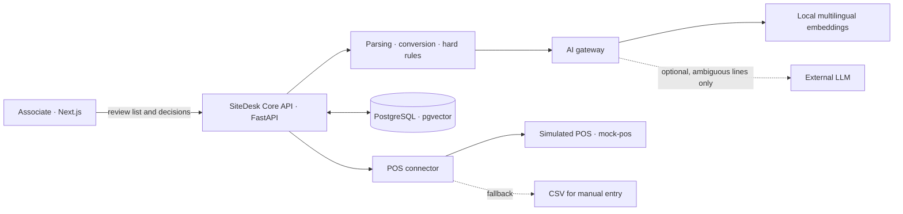

# SiteDesk

**Turn a customer's material list into a reviewable, stock-aware order at the counter.**

SiteDesk is a prototype built for the **IT Consultant Challenge 2026, Round 2**. It helps building-material retailers process lists that arrive as pasted text, PDF, spreadsheet, CSV, or customer email. The associate can review product matches, unit conversions, stock exceptions, and substitutions before confirming an order.

The project focuses on a practical integration problem: add a consistent workflow beside existing POS/ERP systems without pretending to replace them.

## What the prototype demonstrates

- **Two connected journeys:** handle a walk-in customer's list at the counter, or prepare an email quote and re-check price and stock when the customer returns.
- **Reviewable product matching:** local multilingual embeddings retrieve candidates; hard rules block incompatible or incomplete matches; associates resolve exceptions and customers approve substitutions.
- **Order-ready quantities:** convert requested units into sellable pack sizes and make rounding visible.
- **Resilient hand-off:** if matching is unavailable, use rule-based suggestions and manual catalog search; if the POS connector is unavailable, export a CSV with a reference for manual entry.
- **A measurable foundation:** record the challenge's time-to-serve, substitution-acceptance, and zero-touch indicators so a future pilot can assess them with real data.

## How it works



The LLM is optional and does not rank or select SKUs. It can extract attributes from ambiguous lines; values without evidence in the customer's text are discarded. Hard rules remain in control, and the associate confirms the final order. With no API key configured, the LLM stays disabled.

## Technology

| Layer | Technology |
| --- | --- |
| Web application | Next.js 14, React, TypeScript, Tailwind CSS |
| Core API | Python, FastAPI, Pydantic, SQLAlchemy |
| Catalog search | `multilingual-e5-small` embeddings and pgvector |
| Database | PostgreSQL 15 with pgvector |
| POS integration | FastAPI mock service representing a simulated POS/ERP |
| Local environment | Docker Compose |

## Run locally

**Requirements:** Docker Desktop (or Docker Engine with the Compose plugin), running. Plan for about **6 GB** of free disk space: roughly 4.5 GB of images, 1 GB of volumes (database and embedding model), plus build cache.

This folder is the `05_source_code/` part of the SiteDesk archive repository. The original team repository is [KhacToanNguyen-23/IT-Consultant-Challenge-2026](https://github.com/KhacToanNguyen-23/IT-Consultant-Challenge-2026).

### 1. Start

```bash
git clone <archive-repository-url>
cd <archive-repository-folder>/05_source_code
cp .env.example .env            # PowerShell: Copy-Item .env.example .env
docker compose up --build -d    # first build takes several minutes
docker compose ps               # all 4 containers should be "Up"; db and mock-pos "healthy"
```

The first build downloads base images and CPU-only PyTorch. The first backend start then downloads the embedding model (~0.5 GB). Wait until `docker compose logs backend` shows `Application startup complete`.

### 2. Open

| Service | URL |
| --- | --- |
| SiteDesk app | http://127.0.0.1:3001 |
| Core API docs | http://127.0.0.1:8000/docs |
| Simulated POS API | http://127.0.0.1:8001/docs |

The first page load can take a few seconds while Next.js compiles in dev mode. If `localhost:3001` shows a different site, your browser has cached another app from that port: use `127.0.0.1`, an incognito window, or Ctrl+F5.

To try it: on **Counter**, pick the sample **Full counter list**, click **Read list**, then **Analyze**.

### 3. Run the tests (optional)

```bash
# 244 unit + integration tests (uses a separate sitedesk_test database)
docker compose exec -e TEST_DATABASE_URL=postgresql+psycopg2://postgres:password123@db:5432/sitedesk_test backend python -m pytest -q

# Flow 1 acceptance checks against the running stack (33 checks)
docker compose exec backend python -m scripts.acceptance_flow1
```

### 4. Stop and clean up

```bash
docker compose stop                              # stop, keep everything for a quick restart (docker compose start)
docker compose down                              # remove containers, keep images and data
docker compose down --rmi all --volumes          # remove containers, images, database and model cache
docker builder prune -af                         # optional: also clear Docker's build cache (affects all projects)
```

### LLM key

The app can run without an external LLM key; configure one only in your local `.env` if you want to exercise the optional extraction path. Never commit `.env` or API keys.

## Demo and engineering notes

- [Demo cases and walkthrough](docs/demo-case-sheet.md)
- [Round 2 implementation plan](docs/round2-plan.md)
- [System requirements](docs/SiteDesk_MVP_SRS.md)
- [Contribution workflow](CONTRIBUTING.md)
- [Initial matching evaluation](backend/reports/evaluation_2026-11-06.md) — preliminary results on 98 lines; labels are AI-assisted and have not been fully human-reviewed, so they do not establish production accuracy or satisfy the stated sample-size target.

The demo catalog contains 62 seeded products. POS, prices, and inventory are simulated; no stock is reserved and SiteDesk does not send email. Email and phone numbers are masked before AI processing, but this prototype does not guarantee removal of every personal detail. It has not been validated against live POS/ERP systems or production catalogs.

## Repository layout

```text
backend/       FastAPI API, matching pipeline, AI gateway, persistence, tests
frontend/      Next.js associate interface and quote journeys
mock-pos/      Simulated POS/ERP API and deterministic demo catalog
docs/          Requirements, demo walkthroughs, architecture and evaluation notes
docker-compose.yml
```
