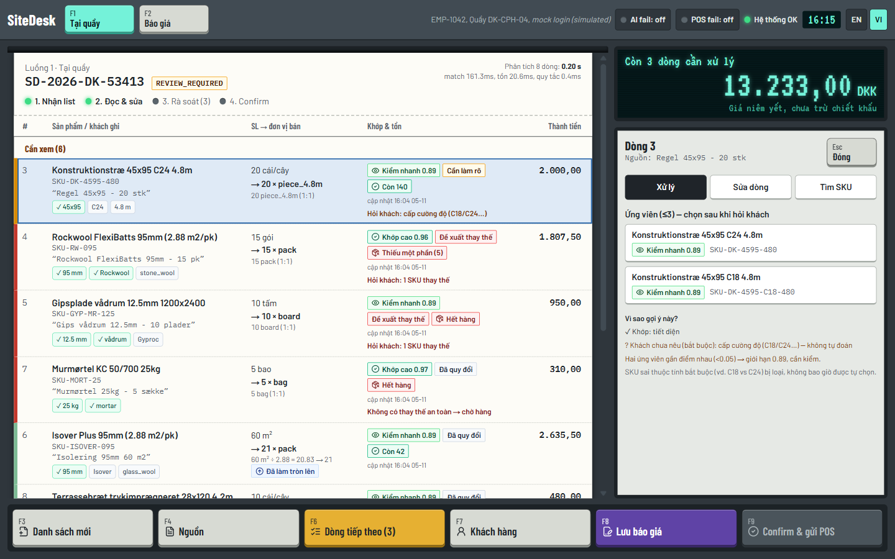
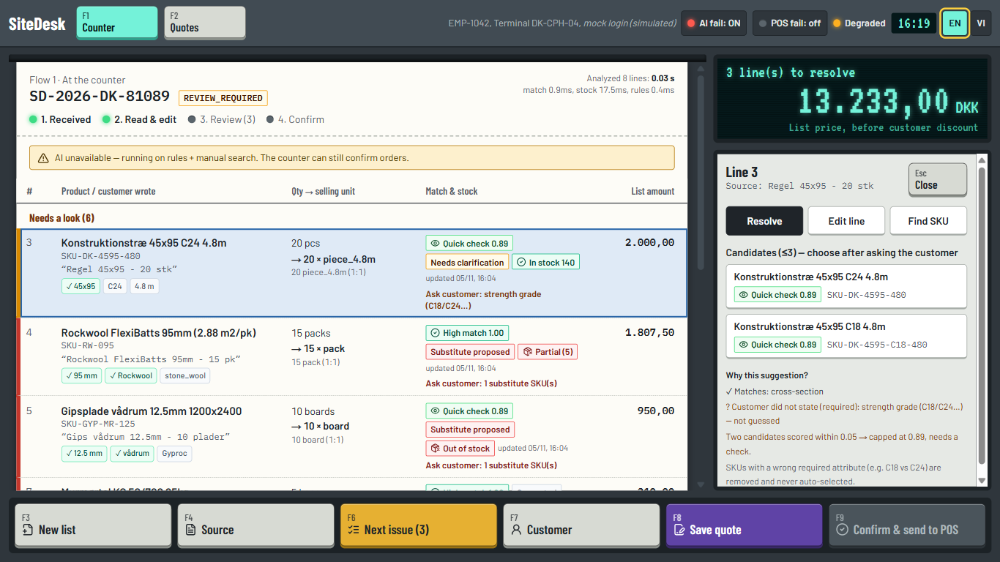
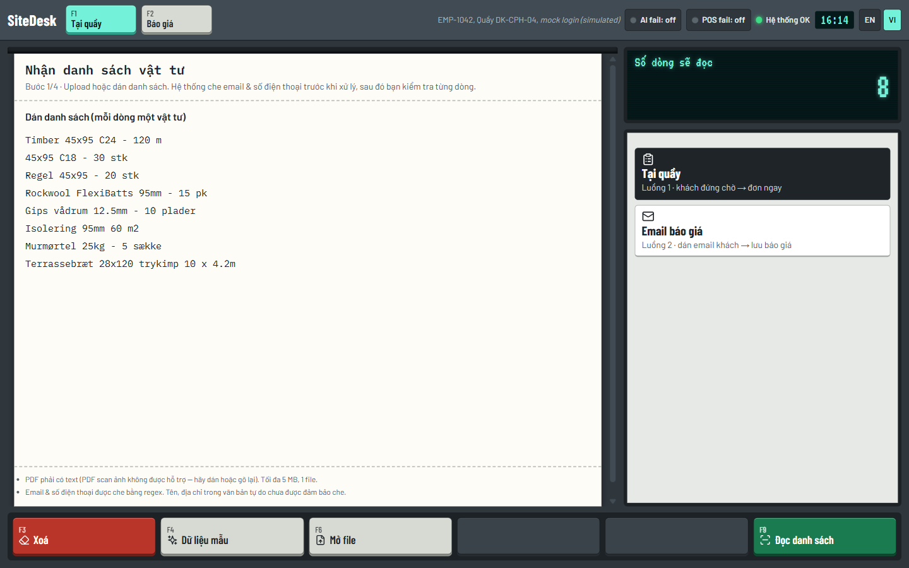
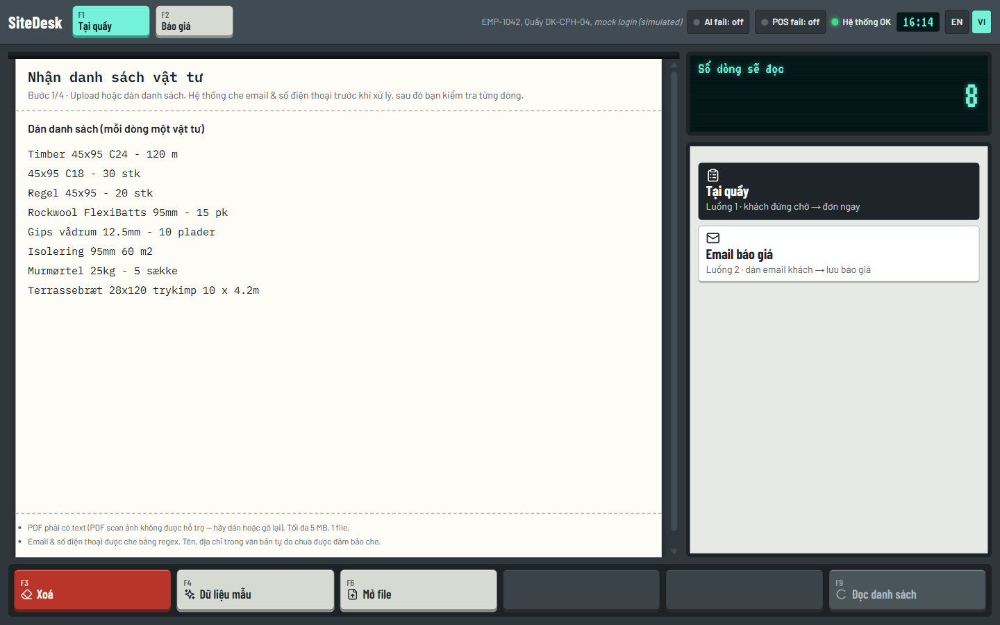
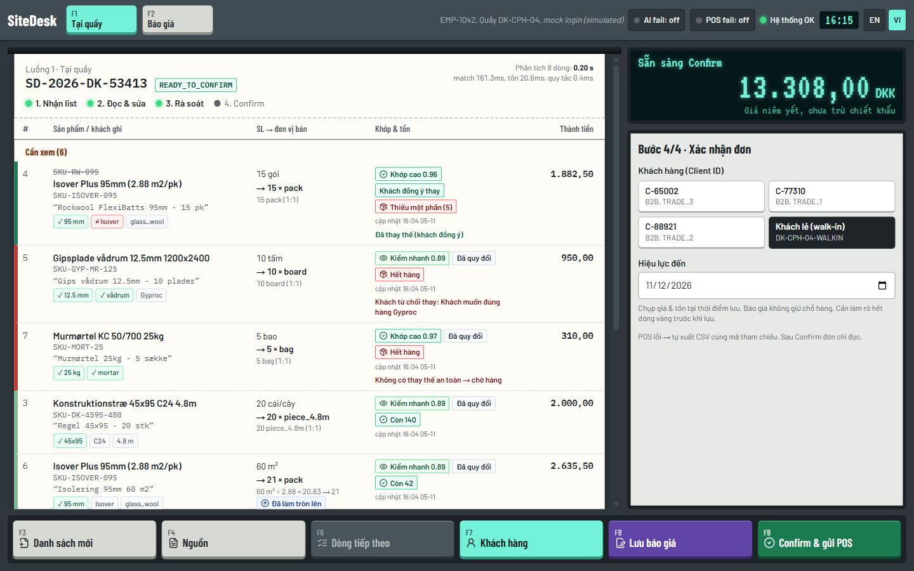
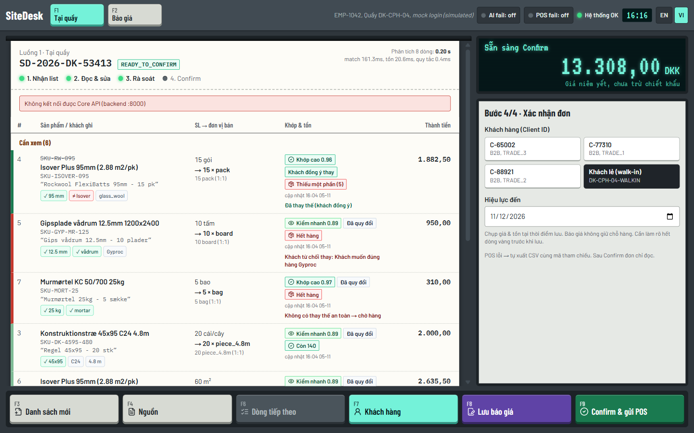
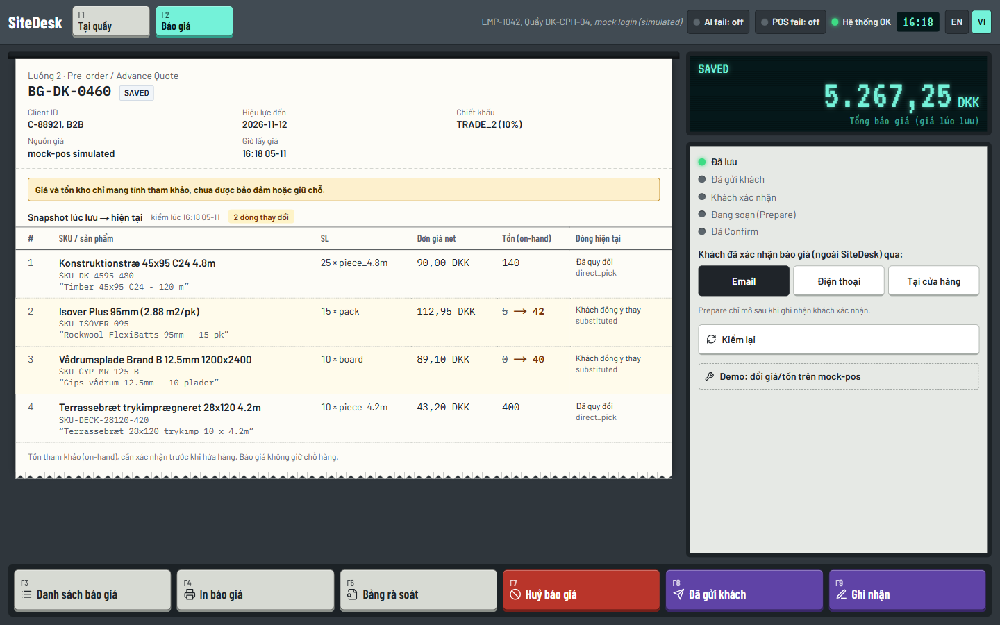
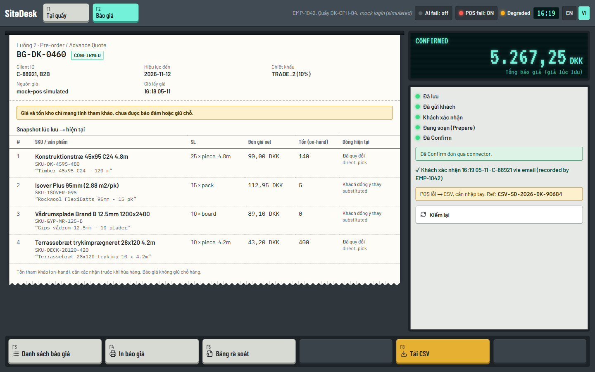

# SiteDesk — IT Consultant Challenge 2026

> **Team orangeCore** · Netcompany × Code MeLy IT Consultant Challenge 2026
> Kết quả: **Qua vòng 1 (top 21 / 160 đội) · Dừng ở vòng 2**

SiteDesk là trợ lý AI tại quầy cho chuỗi bán lẻ vật liệu xây dựng: biến danh sách vật tư khách mang tới (PDF, Excel, email, văn bản dán vào) thành một đơn hàng đã đối chiếu tồn kho, để nhân viên rà soát và xác nhận.



---

## Mục lục

- [1. Cuộc thi](#1-cuộc-thi)
- [2. Đề bài](#2-đề-bài)
- [3. Vấn đề](#3-vấn-đề)
- [4. Giải pháp: SiteDesk](#4-giải-pháp-sitedesk)
- [5. Kết quả](#5-kết-quả)
- [6. Thành viên](#6-thành-viên)
- [7. Công nghệ](#7-công-nghệ)
- [8. Chạy demo](#8-chạy-demo)
- [9. Bài học rút ra](#9-bài-học-rút-ra)
- [10. Cấu trúc thư mục](#10-cấu-trúc-thư-mục)

**File chính**

| Nội dung | File |
|---|---|
| Proposal vòng 1 (10 slide) | [`02_vong_1_proposal/sitedesk_proposal_vong_1.pdf`](02_vong_1_proposal/sitedesk_proposal_vong_1.pdf) |
| Video demo vòng 2 | [`03_vong_2_demo/sitedesk_demo_video.mp4`](03_vong_2_demo/sitedesk_demo_video.mp4) · phụ đề [`.srt`](03_vong_2_demo/sitedesk_demo_subtitle_en.srt) |
| Script video vòng 2 | [`sitedesk_video_script_en.pdf`](03_vong_2_demo/sitedesk_video_script_en.pdf) · [`video_final_script.md`](03_vong_2_demo/video_final_script.md) · [`demo_script.md`](03_vong_2_demo/demo_script.md) |
| AI Journal (nộp vòng 2) | [`03_vong_2_demo/ai_journal_orangecore.pdf`](03_vong_2_demo/ai_journal_orangecore.pdf) |
| User Journey, System Diagram | [`04_thiet_ke/diagrams/`](04_thiet_ke/diagrams/) |
| SRS cho MVP | [`04_thiet_ke/sitedesk_mvp_srs_v2.pdf`](04_thiet_ke/sitedesk_mvp_srs_v2.pdf) · [bản Markdown](05_source_code/docs/SiteDesk_MVP_SRS.md) |
| Source code | [`05_source_code/`](05_source_code/) |
| Screenshot | [`06_hinh_anh/`](06_hinh_anh/) |

---

## 1. Cuộc thi

**IT Consultant Challenge 2026** do **Netcompany** và **Code MeLy** tổ chức, dành cho sinh viên và người mới đi làm. Mỗi đội đóng vai một nhóm tư vấn IT, giải một case doanh nghiệp thật từ phân tích vấn đề tới MVP chạy được.

| Vòng | Thời gian | Yêu cầu |
|---|---|---|
| Vòng 1: Proposal | 16/10 – 26/10/2026 | Proposal tối đa 10 slide (PDF) |
| Vòng 2: Build-a-thon | 02/11 – 09/11/2026 | MVP chạy được, video demo ≤ 7 phút, User Journey, System context diagram, AI Journal |
| Vòng 3: Pitching | 16/11 – 21/11/2026 | Thuyết trình chung kết |

Vòng 1 có 160 đội tham gia, 21 đội vào vòng 2.

## 2. Đề bài

**Company A** là nhà bán lẻ vật liệu xây dựng hàng đầu Đan Mạch, có hàng trăm cửa hàng tại Đan Mạch, Na Uy và Thụy Điển, phục vụ cả nhà thầu (B2B) lẫn khách lẻ (B2C). Mỗi quốc gia tự phát triển hệ thống và quy trình riêng, dẫn tới bốn vấn đề: quy trình thủ công, vận hành không đồng nhất, khó khăn trong giao hàng và hoàn tất đơn, hệ thống phân mảnh. Mức độ ưu tiên khác nhau theo thị trường: Đan Mạch nặng về quy trình thủ công, Na Uy về vận hành cửa hàng, Thụy Điển về giao hàng.

**Nhiệm vụ:** chọn **một** cơ hội kinh doanh, giải thích vì sao ưu tiên nó, đề xuất giải pháp số cùng phạm vi MVP, và tính đến cách triển khai ở cả ba thị trường. Đề bài nhấn mạnh rằng time to market là yếu tố then chốt.

## 3. Vấn đề

Ba ưu tiên của ba thị trường đều gặp nhau ở **quầy bán hàng**. Nhà thầu mang tới danh sách vật tư 20–35 dòng (PDF, Excel, email), và nhân viên phải:

1. đọc từng dòng,
2. tra mã SKU trong hệ thống POS/ERP cũ,
3. kiểm tra tồn kho,
4. nếu hết hàng thì nhờ người có kinh nghiệm gợi ý sản phẩm thay thế,
5. nhập lại toàn bộ vào POS.

Đội ước tính quy trình này mất **khoảng 12 phút cho mỗi danh sách**. Kết quả phụ thuộc vào người đứng quầy, dễ nhập sai, và gây mất đơn khi hết hàng.

**Nguyên nhân gốc (phân tích 5 Whys):** công ty chưa có cách dùng chung, dựa trên dữ liệu, để biến danh sách của khách thành đơn hàng. Hiểu biết về sản phẩm tương đương nằm trong đầu nhân viên chứ không nằm trong hệ thống.

Đội so sánh năm phương án bằng ma trận có trọng số: SiteDesk, ERP hợp nhất, ứng dụng quản lý công việc cửa hàng, RPA back-office và hệ thống giao hàng. SiteDesk được điểm cao nhất (4.20) vì vừa có tác động lớn vừa ra mắt được trong một quý.

## 4. Giải pháp: SiteDesk

**Nguyên tắc: AI đọc danh sách, con người ra quyết định.**

| Bước | Ai làm | Nội dung |
|---|---|---|
| 1. Đọc | AI | Nhận PDF, Excel, CSV, email hoặc văn bản dán vào, tách thành từng dòng |
| 2. Khớp | AI và luật | Dùng tìm kiếm ngữ nghĩa để khớp mô tả của khách với SKU, quy đổi đơn vị sang quy cách bán |
| 3. Kiểm tra | Hệ thống | Kiểm tra tồn kho và đề xuất sản phẩm thay thế còn hàng. Luật cứng loại các ứng viên sai thuộc tính |
| 4. Xác nhận | Con người | Nhân viên rà soát, khách đồng ý phương án thay thế, đơn được đẩy sang POS |

**Mục tiêu đặt ra ở vòng 1** (ước tính của đội, chưa phải số đo thực tế): giảm từ 12 phút xuống dưới 2 phút cho mỗi danh sách, giữ lại ít nhất 30% số dòng hết hàng, mang lại khoảng €14M/năm khi triển khai toàn bộ. Đội đề xuất làm MVP trong 12 tuần tại 10 cửa hàng ở Na Uy, chi phí khoảng €0.6M.

**MVP vòng 2** thể hiện hai luồng chính:
- **Luồng 1: Tại quầy.** Nhân viên tải danh sách lên, rà soát, xử lý các dòng ngoại lệ, xác nhận rồi gửi sang POS.
- **Luồng 2: Báo giá qua email.** Hệ thống tạo báo giá, rồi kiểm tra lại giá và tồn kho khi khách quay lại.

Ngoài ra MVP có các cơ chế dự phòng: khi AI không hoạt động, hệ thống chạy bằng luật và tìm kiếm thủ công; khi POS không hoạt động, hệ thống xuất CSV để nhập tay. LLM là tùy chọn và chỉ hỗ trợ đọc các dòng mơ hồ, không bao giờ tự chọn SKU.



<details>
<summary>Thêm screenshot</summary>

| | |
|---|---|
|  |  |
|  |  |
|  |  |

</details>

## 5. Kết quả

- **Vòng 1:** Qua vòng, nằm trong 21 / 160 đội vào vòng 2.
- **Vòng 2:** Đã nộp đủ MVP, video demo, User Journey, System Diagram và AI Journal. **Đội dừng ở vòng 2**, không vào vòng Pitching.

Lưu ý: MVP chạy local với POS, giá, tồn kho và danh mục sản phẩm đều là dữ liệu giả lập (62 sản phẩm mẫu). Bộ đánh giá khớp sản phẩm gồm 98 dòng, nhãn do AI hỗ trợ gắn, nên kết quả chỉ mang tính sơ bộ.

## 6. Thành viên

| Thành viên | Vai trò |
|---|---|
| Nguyễn Khắc Toàn | Software Engineer |
| Nguyễn Đức Huy | Software Engineer |
| Lê Hoàng Triết Thông | Software Engineer |

Repo gốc của đội: [KhacToanNguyen-23/IT-Consultant-Challenge-2026](https://github.com/KhacToanNguyen-23/IT-Consultant-Challenge-2026). Thư mục `05_source_code/` là bản sao để lưu trữ.

## 7. Công nghệ

| Tầng | Công nghệ |
|---|---|
| Web app | Next.js 14, React, TypeScript, Tailwind CSS |
| Core API | Python, FastAPI, Pydantic, SQLAlchemy |
| Tìm kiếm danh mục | Embedding `multilingual-e5-small` + pgvector |
| Cơ sở dữ liệu | PostgreSQL 15 + pgvector |
| Tích hợp POS | Dịch vụ FastAPI mô phỏng POS/ERP (`mock-pos`) |
| Môi trường | Docker Compose |
| LLM (tùy chọn) | Gọi qua AI gateway, chỉ dùng cho các dòng mơ hồ |

Công cụ AI đội dùng trong quá trình phát triển: Claude Code, Codex, OpenCode, Orca (chi tiết trong [AI Journal](03_vong_2_demo/ai_journal_orangecore.pdf)).

## 8. Chạy demo

**Yêu cầu:** Docker Desktop đang chạy (hoặc Docker Engine có Compose plugin), trống khoảng 6 GB ổ đĩa.

```bash
cd 05_source_code
cp .env.example .env        # PowerShell: Copy-Item .env.example .env
docker compose up --build -d
```

| Dịch vụ | URL |
|---|---|
| Ứng dụng | http://127.0.0.1:3001 |
| API docs | http://127.0.0.1:8000/docs |
| POS giả lập | http://127.0.0.1:8001/docs |

Lần chạy đầu sẽ tải model embedding (khoảng 0.5 GB). Ứng dụng chạy được mà không cần API key của LLM. Các ca demo có trong [`demo-case-sheet.md`](05_source_code/docs/demo-case-sheet.md).

Hướng dẫn đầy đủ (chạy test, dừng, dọn dẹp Docker) nằm trong [`05_source_code/README.md`](05_source_code/README.md#run-locally). Dọn sạch sau khi chạy xong:

```bash
docker compose down --rmi all --volumes
```

## 9. Bài học rút ra

<!-- Phần này để trống cho tác giả tự viết. -->

## 10. Cấu trúc thư mục

```text
.
├── 02_vong_1_proposal/     Proposal vòng 1 đã nộp
├── 03_vong_2_demo/         Video, phụ đề, script, AI Journal vòng 2
├── 04_thiet_ke/            SRS, User Journey, System Diagram
├── 05_source_code/         Backend, frontend, mock-pos, tài liệu kỹ thuật
├── 06_hinh_anh/            Screenshot MVP
└── 99_luu_tru/             Bản nháp, thử nghiệm AI, ghi chú, footage gốc
```
